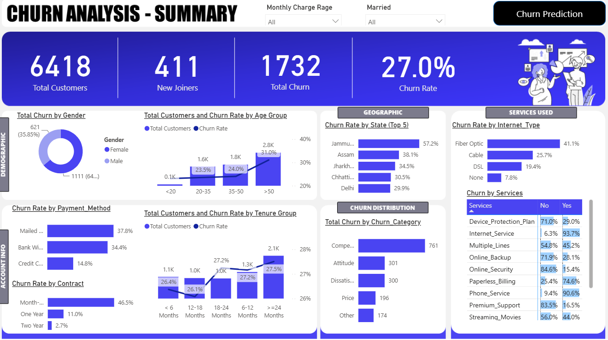
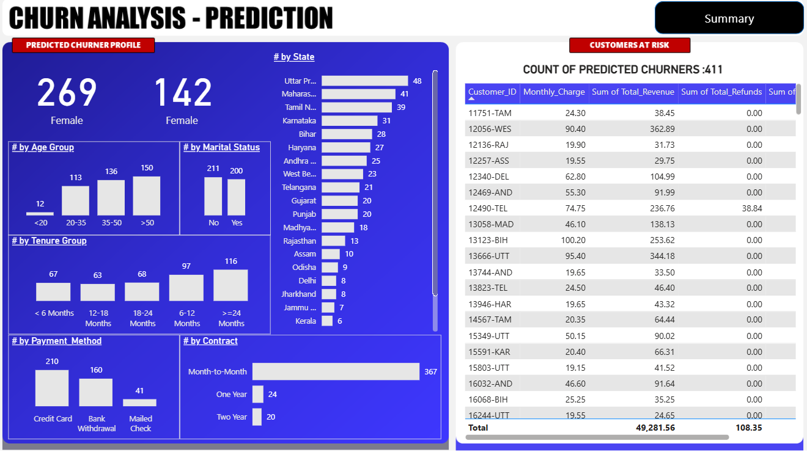

# 📊 Customer Churn Analysis – End-to-End Data Analytics Project

## 📌 Project Overview

This project focuses on analyzing customer churn using an end-to-end data analytics workflow. The objective is to identify key factors influencing customer churn, understand customer behavior, and generate actionable business insights using SQL Server, Power BI, and Python.

The project covers data exploration, SQL-based analysis, interactive dashboard development, and machine learning-based churn prediction.

## 🗂️ Dataset

- Customer churn dataset in CSV format.
- Contains customer demographics, service usage, billing details, and churn status.
- Dataset loaded into SQL Server for analysis.
- Dataset source: Add the original dataset source or download link here.

## 🛠️ Tools & Technologies

| Tool | Purpose |
|---|---|
| SQL Server / SSMS | Data loading and SQL-based analysis |
| SQL | Data cleaning, aggregation, and business analysis |
| Power BI | Interactive dashboard development |
| Python | Data preprocessing and machine learning |
| Pandas & NumPy | Data manipulation |
| Scikit-learn | Model building and evaluation |
| Jupyter Notebook | Model development and experimentation |

## 🔍 SQL Exploratory Data Analysis

Performed SQL-based exploratory data analysis using SQL Server Management Studio.

Key activities:
- Checked data quality, NULL values, and duplicates.
- Analyzed overall customer churn distribution.
- Examined churn trends based on:
  - Customer tenure
  - Services used
  - Contract type
  - Monthly charges
- Created aggregated queries to support dashboard metrics.

## 📈 Power BI Dashboard

Developed an interactive Power BI dashboard consisting of three pages.

**1. Churn Analysis – Summary**
- Total customers and new joiners.
- Total churn and overall churn rate.
- Churn analysis by gender and age group.
- Churn trends by state, internet type, payment method, and contract.
- Customer service usage analysis.

**2. Churn Reason**
- Analysis of customer churn reasons.
- Identification of common factors associated with customer dissatisfaction.

**3. Churn Prediction**
- Predicted churner customer profiles.
- Customer distribution by age, marital status, and tenure.
- Customer risk analysis by state and payment method.
- Table displaying predicted churner details.

## 📸 Dashboard Screenshots

### 1. Customer Churn – Summary Dashboard



### 2. Customer Churn – Prediction Dashboard



## 🤖 Machine Learning – Churn Prediction

Implemented a Random Forest Classifier to predict customer churn.

Key steps:
- Data preprocessing and feature encoding.
- Train-test split.
- Random Forest model training.
- Model evaluation using classification metrics.
- Confusion matrix analysis.
- Feature importance analysis.

### Model Performance

| Metric | Churn Class (1) |
|---|---:|
| Precision | 83% |
| Recall | 62% |
| F1-Score | 71% |

**Overall Model Accuracy: 85%**

The model identifies important factors influencing customer churn, including total revenue, contract type, total charges, and monthly charges.

## ✅ Key Business Insights

- Identified customer segments with higher churn tendencies.
- Analyzed the relationship between contract types and customer churn.
- Explored the impact of payment methods and services on churn.
- Identified important features influencing churn predictions.
- Presented business-friendly insights through interactive dashboards.

## 🚀 How to Run the Project

1. Download or clone this repository.
2. Load the customer churn CSV dataset into SQL Server.
3. Open `etl_queries.sql` in SQL Server Management Studio.
4. Execute the SQL queries for data exploration and analysis.
5. Open `Churn Analysis.pbix` using Power BI Desktop.
6. Explore the interactive dashboard pages.
7. Open `Churn_Prediction.ipynb` in Jupyter Notebook.
8. Install the required Python libraries and execute the notebook cells.

## 📁 Project Structure

```text
Customer-Churn-Analysis/
│
├── images/
│   ├── churn-summary.png
│   ├── churn-prediction.png
│   └── README.md
│
├── Churn Analysis.pbix
├── Churn_Prediction.ipynb
├── etl_queries.sql
├── README.md
└── LICENSE
```

## 👩‍💻 Author

**Sneha Nomula**

Aspiring Data Analyst | SQL | Python | Power BI

GitHub: [SnehaNomulaa](https://github.com/SnehaNomulaa)

## 📌 Project Reference

This project was adapted from an existing public GitHub project, with attribution to the original repository:

[Original Customer Churn Analysis Repository](https://github.com/akshithkumar07/Customer_Churn_Analysis)

